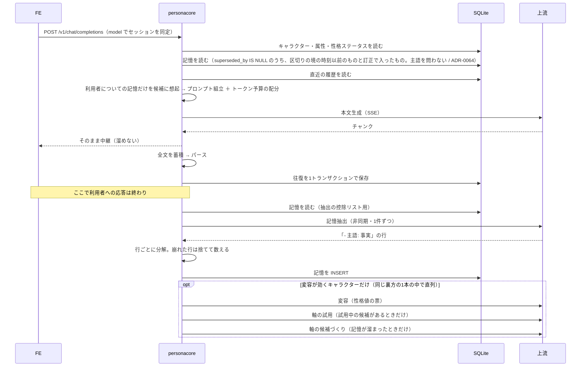

# 02. アーキテクチャ

## 全体構成

```
 ┌──────────────────────────────────────────────┐
 │ FE（既存の OpenAI 互換チャットクライアントで可） │
 └───────────────┬──────────────────────────────┘
                 │ POST /v1/chat/completions (SSE)
                 │ GET  /v1/models
                 ▼
 ┌──────────────────────────────────────────────┐        ┌──────────┐
 │ personacore                                  │◀──────▶│  SQLite  │
 │                                              │ store  └──────────┘
 │   server ── prompt ── domain                 │
 │      │        │                              │◀── /admin/…（人が叩く）
 │      │        └── parse                      │
 │      └── llm (trait)                         │
 └───────────────┬──────────────────────────────┘
                 │ ①本文生成（SSE で中継）
                 │ ②記憶抽出（応答を返し切った後・非同期）
                 │ ③変容 → 軸の試用 → 軸の候補づくり（②の後に順に。変容が効くキャラクターだけ）
                 ▼
 ┌──────────────────────────────────────────────┐
 │ 上流（起こす llama / 繋ぐ先のサーバ）        │
 └──────────────────────────────────────────────┘
```

本サービスは**両側で OpenAI 互換規格を話す中間層**。判断の背景は
[ADR-0001](adr/0001-openai-compatible-boundary.md)。
上流の面は、上流プロファイルに gguf を書けば personacore が頼まれたときに `llama serve` を起こし、
書かなければ既に動いているサーバ（LM Studio・中継など）へ繋ぐ
（[ADR-0042](adr/0042-the-executable-owns-the-upstream-it-starts.md)。上流に求める能力は
[ADR-0038](adr/0038-what-personacore-requires-of-an-upstream.md)）。

**上流へは1ターンにつき、本文生成の1回に加えて、裏方の依頼が最大4回**走る。
記憶抽出の後に、変容（[ADR-0024](adr/0024-stat-drift.md)）・軸の試用・軸の候補づくり
（[ADR-0046](adr/0046-drift-proposes-new-axes.md)）が**別の依頼として順に**走る
（`src/server/extract.rs` の `run`。後ろの3つは変容が効くキャラクターだけで、試用と候補づくりはさらに、見いだす枠 `axis_discovery_slots` が 1 以上で条件が揃った回だけ）。
**裏方は全部、応答を返し切った後**なので、利用者からは見えない（[ADR-0021](adr/0021-memory-extraction-format.md) §6）。
同時に走る裏方は1本だけで、4つはその1本の中で直列に回る（ADR-0021 §7）。

## 1ターンで何が起きるか

**記憶はベクトル検索していない。** 本文に載るのは、**利用者についての記憶のうち、想起が選んだ分**
（[ADR-0023](adr/0023-three-layer-recall.md) の3層想起 / [ADR-0050](adr/0050-consolidating-memories-into-experience.md) §決め直し 1）。
`store`（`Store::recall_memories`）は有効な記憶を**主語を問わず**返す。本文の経路では、抽出で増えた記憶を
10 往復ごとの区切りまで待たせるため、境の時刻以前に作られた記憶（と訂正で入った記憶）に絞って返す
（`RecallScope::AsOf` / [ADR-0064](adr/0064-extracted-memories-reach-the-prompt-in-steps-of-ten-turns.md)）。裏方の要求には全件を返す。
**主語で絞るのも、想起で選ぶのも `prompt` の側**（`build_prompt`）。キャラクター自身についての記憶は、
本文には載らないが、抽出と軸の候補の依頼には載る。
（かつての全件注入 [ADR-0003](adr/0003-full-memory-injection.md) は ADR-0023 で置換済み。）



**書き込みは毎ターン増える。読み出しは毎ターン全件で、選ぶのは `prompt`。** この2つが同じ表を挟んで回っている。

### 記憶を検索に切り替える引き金 —— 移行は済んだ

~~**件数ではなくトークン予算で判断する**（ADR-0003）。
**`memory_tokens` がプロンプト取り分の半分を超えたら `warn`**（`prompt::budget` に実装済み）。~~
**→ 撤去済み**（15b）。移行そのものが [ADR-0023](adr/0023-three-layer-recall.md) の3層想起で済み、
選別の導入後は記憶が増えると鳴りっぱなしになったため（`src/prompt/budget.rs` のモジュール doc）。
**後継は `report_recall` の `info`**（想起で引いた件数・引かなかった件数 `omitted`・主語で外した件数 `excluded_own`）。

> **「履歴が削られたら」でもない。** 会話は無限に伸びるので**履歴が削られること自体は正常**で、
> それを信号にすると鳴り続ける。

## モジュール境界

単一クレート + モジュール分割（[ADR-0002](adr/0002-single-crate-module-layout.md)）。
将来 workspace へ分割できるよう、モジュール境界は crate 境界のつもりで引く。

| モジュール | 責務 | I/O | テスト方針 |
|---|---|---|---|
| `domain` | ドメイン型と不変条件（`Subject` / `Handle` / `MemoryContent` 等） | なし | 単体テストを厚く |
| `prompt` | プロンプト組立、**トークン予算配分** | なし | 単体テストを厚く |
| `parse` | 台詞 / 地の文のパース、抽出出力のパース、軸名の漏れ検出 | なし | 単体テストを厚く。異常系必須 |
| `llm` | 上流（OpenAI 互換の推論サーバ）のクライアント。**トレイトで抽象化** | HTTP | モック注入。実通信テストは別枠 |
| `store` | SQLite 永続化（sqlx） | DB | tempfile で一時DB |
| `server` | axum。OpenAI 互換ルーティング、SSE 中継、`/admin/`、記憶抽出の起動 | HTTP | 統合テスト |

**ロジックは上3つ（純粋関数側）に寄せ、下3つは薄く保つ。**
`llm` / `store` / `server` に条件分岐が増え始めたら、それは `domain` / `prompt` に
移すべきロジックが漏れ出しているサイン。

**`image_prompt`（フェーズ3）は未着手**（[07-prompt-compiler.md](07-prompt-compiler.md)）。

## 型で潰すバグ

Rust を選んだ理由は、記憶の状態管理が本システムの中核であり、
状態遷移を型で表現できることが決定的だから。**`Option<T>` や `bool` で済ませず、
状態は enum で表現すること。**

実際に効いている例:

| 型 | 何を不可能にしたか |
|---|---|
| `Subject` | 「誰についての記憶か」を落とせない（絶対制約） |
| `Handle` / `DisplayName` | 識別子を表示名として使えない（[ADR-0011](adr/0011-character-handle-and-display-name.md)） |
| `SafeText` / `PromptWriter` | プロンプトに書ける手段が「開発者が書いた定数」と「引用行」の2つだけ |
| `MemoryContent` / `Persona` 等 | **削れない枠に載る自由文が必ず上限を持つ**（絶対制約） |
| `ValidTag`（フェーズ3） | 辞書引き以外の構築手段が無い（[ADR-0006](adr/0006-slot-based-tag-compilation.md)） |

> **⚠ 当初この節には `enum MemoryState { Active, Superseded, Locked }` を載せていたが、
> 実装していない**（2026-08-22 に訂正）。
> **`Memory` は `superseded_by` を持たない。** 想起は SQL 側で
> `WHERE superseded_by IS NULL` を掛け、**読み出した時点で有効なものしか存在しない**形にした
> （`store::memory`）。状態を型で持つより、**取り違えようのない値だけを返す**方が強い。
> 上書きの経路は [ADR-0022](adr/0022-repairing-memories-without-deleting.md)。

> **⚠ 「型で表現できなくした」と書く前に、表現できてしまう実装を実際に書いてみること。**
> `enum { Readable, Unreadable }` を「呼び出し側が無視できない形」と書いたが、
> **`filter_map` で捨てる実装はそのままコンパイルが通った。** 守っていたのはテストだった。

## ストリーミング中継

**SSE を受けて SSE を返す二段構成**であり、ここが体感品質を最も左右する。

```
上流 ──SSE──► personacore ──SSE──► FE
```

- **バッファリングで詰まると体感が死ぬ。** チャンクを溜め込まず、受けたそばに流す。
  例外は、本文が空のまま終わった回を引き直す（最大2回）ために、`finish_reason` 付きのチャンクと終わりの印を保留するときだけ（[ADR-0059](adr/0059-thinking-and-response-room-in-the-upstream-profile.md) §決定3・追記（2026-11-13））。`finish_reason` 付きのチャンクが無いまま終わった空の回では、終わりの印だけを保留する。
- 中継しつつ、本文全体を蓄積して**ストリーム終了後に**パース・永続化する。
  **保存するのは `[DONE]` を流した回**で、上流が正常に終わった回と、下の暴走で打ち切った回がそれに当たる。
  上流が途中で壊れた回と、利用者が切った回は保存しない。
- **返答の暴走が十分に長くなったら、中継は上流の生成を打ち切る**（[ADR-0062](adr/0062-runaway-repetition-is-folded-for-the-model-and-cut-in-the-relay.md) §決定4）。
  受けた生の差分に暴走の区間を数え足し、畳む区間の長さの合計が 256 文字に達したら、そのチャンクを流して上流を落とし、
  `finish_reason: "length"` と終わりの印を流して保存する。**時間の値で打ち切るのではない**（下の無通信とは別の話）。
- 上流が切れた場合、下流へ適切に終端を送る。接続を宙吊りにしない。
- **FE が切断したら上流をキャンセルする**（[ADR-0019](adr/0019-relay-idle-watchdog.md)）。
- **無通信が続いても、中継は固定の秒数で打ち切らない。** 番人は沈黙を報告するだけで、
  打ち切りの天井は `llm` 層が持ち、止めるかは待っている人が決める（[ADR-0035](adr/0035-the-watchdog-reports-the-human-decides.md)）。
  **天井で打ち切られた回は保存しない**（[ADR-0019](adr/0019-relay-idle-watchdog.md) §4。上の暴走の打ち切りとは別で、こちらは上流が壊れた回と同じ扱い）。

## サブLLM呼び出しのタイミング

**本文生成のレスポンスを返し切った後に、非同期でメモリ抽出を走らせる**（絶対制約）。

```
[FE] ──► [本文生成] ──► [FE へ応答完了]
                              │
                              └──► [記憶抽出]（非同期・FE を待たせない）
```

> **⚠ 当初は「抽出は 3B、本文は 14B」と書いていたが、既定は本文と同じ 14B に変えた**
> （2026-08-21 の実測。[ADR-0021](adr/0021-memory-extraction-format.md) §10）。
> **3B は主語を間違え、形式が 41% 崩れる。** `memory` に更新も削除も無い以上、
> **遅くても正確な方を採る。**
> **同じモデルなので、上流が2つ目をロードしなくて済むという副次的な利点もある。**

> **⚠ 「Parallel 4 だから並行させても捌ける」とも書いていたが、
> 抽出は同時に1件しか走らせない**（[ADR-0021](adr/0021-memory-extraction-format.md) §7）。
> **走っている最中に来た分は捨てて数える。** 待ち行列にしないのは、
> **停止時に落ちるので結局失われ、溜まっていることも見えない**ため。

## OpenAI 互換の履歴と自前永続化の二重管理

OpenAI 互換クライアントは**毎回全履歴を送ってくる**。一方、本サービスは自前の SQLite を持つ。

方針: **自前DBを正とし、クライアント送信分は最新メッセージのみ採用する。**

そのリクエストがどのセッションのものかは、**`model` フィールドで同定する**
（[ADR-0004](adr/0004-session-identification.md)）。

| `model` の値 | 意味 |
|---|---|
| `aoi` | `aoi` の最新セッションを継続。無ければ暗黙に作成 |
| `aoi@new` | 新規セッションを作成し、以後 `aoi` はそれを継続 |
| `aoi@<session-id>` | 指定セッションを継続（一覧には出さない。復旧・デバッグ用） |

`GET /v1/models` には**キャラクターのみ**を並べる。セッションは並べない。

> **`model` はクライアントから来る信頼できない入力。**
> 既知のキャラクター名の許可リストと照合し、一致しなければ 404 を返す。
> 解釈は**単一の関数に閉じ込める**（`domain::ModelSelector`）。

## 管理 API

**書き込み経路を1つに保つ**ため、キャラクターの管理は `/admin/` の HTTP API に置く
（[ADR-0008](adr/0008-admin-api.md)）。**`127.0.0.1` にのみバインドする。**
**バインドだけでは足りないので、`Host` / `Origin` / 要求の authority を全部の経路の手前で検査する**
（`src/server/host_guard.rs` / origin#54 B-58。外れたら 403 `request_origin_not_allowed`。
版を上げない例外の扱いは [ADR-0047](adr/0047-the-api-is-the-product.md)、規則は CLAUDE.md §1）。

> **⚠ 下の表は要約であって、正ではない。**
> **正は `src/server/admin.rs` のモジュール doc**（生やす・生やさないの理由もそこにある）。
> **⚠ 2026-08-27 に、この表が3箇所古くなっていた** —— **読み出しの入口が丸ごと落ちており、
> 「記憶を直す導線はまだ無い」という一文が偽になっていた**（14a / 14b で実装済み）。
> **写した表は、片方を直したときに黙って古びる**（CLAUDE.md）。**ここを見て判断しないこと。**

| ルート | できること |
|---|---|
| `POST /admin/characters` | 作成 |
| `GET /admin/characters` | 一覧（**壊れた行も「壊れている」と示す**） |
| `PATCH` / `DELETE /admin/characters/{handle}` | 更新・削除（[ADR-0016](adr/0016-character-update-and-delete.md)）。**`PUT` は意図的に無い**（§1・405 が固定されている）。**`PATCH` の `archived` でしまう・戻す**（しまったキャラクターは `GET /v1/models` に出ず、chat は 409 `model_archived`。中身は変えない）。**`DELETE` が通るのは会話が無いときか、しまってあるときで、しまってあれば会話・記憶ごとカスケードで消える**（しまっておらず会話があれば 409 `character_has_sessions` / [ADR-0049](adr/0049-deleting-characters-and-conversations.md)） |
| `PUT` / `GET /admin/characters/{handle}/stats` | 性格ステータスの丸ごと置き換えと取得 |
| `PUT` / `GET /admin/characters/{handle}/attributes` | 属性の丸ごと置き換えと取得（[ADR-0009](adr/0009-character-attributes-and-facts.md)） |
| `GET /admin/characters/{handle}/axis-candidates` | **軸の候補**（[ADR-0046](adr/0046-drift-proposes-new-axes.md) §決定6 / A-9a）。いまの状態（移り変わりから導出）・移り変わり・試用の票の内訳。**読むだけ。書き込みも1件を指すパスも無い**。上限があり、**総数も返す** |
| `GET /admin/characters/{handle}/attributes/revisions` | **属性の変更の履歴**（[ADR-0028](adr/0028-attributes-that-change.md) §決定5 / A-3a）。**読むだけ。書き込みも1件を指すパスも無い**。上限があり、**総数も返す** |
| `GET /admin/characters/{handle}/memories` | **修復のための一覧**（[ADR-0022](adr/0022-repairing-memories-without-deleting.md) §2）。**読むだけ。想起とは別の入口**。**`?include=superseded` で上書き済みの節が増える**（D-3b。**既定は変わらない**） |
| `POST /admin/.../memories/{memory_id}/corrections` | **訂正版を足す。** **`POST`＝行の追加**であり、起きることもそれ |
| `GET /admin/characters/{handle}/sessions` | **会話の一覧**（D-12c-1 / Issue origin#35）。**読むだけ。** 並びは**素の `aoi` が続ける順**（先頭が続ける会話・空のセッションは後ろ）。上限があり、**総数も返す** |
| `GET /admin/characters/{handle}/sessions/{session_id}/messages` | **1つの会話のメッセージ**（D-12c-1）。**読むだけ。** 古い順のページを `?before=<メッセージ id>` で遡る（`?limit=` は既定と上限あり）。**他のキャラクターのセッションは 404。書き込みも1件を指すパスも無い** |
| **`GET /admin/upstream`** | **上流の観測**（面ごとに 宛先・依頼するモデル・上流が申告した窓・どちらの読み手が答えたか・`measured` の内訳 / [ADR-0039](adr/0039-two-upstreams-for-two-jobs.md) §決定4 / G-10）。**この口は読むだけ。** 変えるのは下の3つ（[ADR-0042](adr/0042-the-executable-owns-the-upstream-it-starts.md) §決定4・5・8。**モデルを探す・落とす導線は今も無い**）。**⚠ `/v1/models` はキャラクター一覧のまま**（ADR-0004。上流のモデルを混ぜない）。**⚠ 内部パスと認証情報は出さない**（gguf の絶対パスは保持していない / 認証情報は落として `***@` を残す。宛先のクエリとフラグメントも落とす / B-71） |
| `POST /admin/upstream/check` | **両方の面の上流に、いま照会する**（画面の「いま確かめる」/ 応答は `GET /admin/upstream` と同じ形 / B-66 / [ADR-0020](adr/0020-context-length-requery.md) の追記）。中身は5分ごとの照会と同じで、**コンテキスト長を書いた面は観測だけ**（予算を変えない）。両方の面の照会が走っていれば2本目を並べず、それが最後まで走るのを待って返す（`409` にしない）。観測には面ごとに `checked_at` / `check_result`（まだ確かめていない・答えた・繋がらない・一覧に答えない・断られた・鍵を送っていない）が載る |
| `POST /admin/upstream/profile` | **走ったまま上流を差し替える**（本文 `{ "name" }`。gguf の面は子を止めて起こし直す。進行中は `409` / ADR-0042 §決定4 / F-4b-2） |
| `GET /admin/upstream/profiles` | **`upstreams.json` に書いたプロファイル**（書いたままの値・書けるか・内容の印 / §決定8 / F-4b-3）。**観測した値（上の `GET /admin/upstream`）とは混ぜない** |
| `PUT /admin/upstream/profiles/{name}` | **1つのプロファイルを足す・直す**。書くのは既定の置き場所だけ、置き換えで書く、印が違えば `409`、検証に通らなければ `422`。**消す口は無い** |
| `GET /admin/characters/{handle}/drift` | **変容の履歴**（[ADR-0024](adr/0024-stat-drift.md) §9 の追記 / D-4a）。**読むだけ。書き込みも1件を指すパスも無い**。直近の票に上限があり、**総数も返す** |

> **⚠ `memory` を消す・書き換える経路はここに生やさない**（絶対制約）。
> **1件の記憶を指すパス（`.../memories/{id}`）が存在しない**ので、**`PUT` と `DELETE` の置き場も無い。**
> 見張り番は `tests/server_admin.rs::no_admin_endpoint_deletes_or_rewrites_a_memory`。
>
> **⚠ 上書きされた記憶は、訊いたときだけ返る**（`?include=superseded` / D-3b / 2026-08-28）。
> **既定は今までどおり `superseded_by IS NULL` の行だけ。** **画面はまだ無い**（D-3c）。

## コンテキスト予算

メインモデルの実用コンテキストは**起動時と定期的に上流へ引き直す**
（[ADR-0020](adr/0020-context-length-requery.md)）。実測 16384。
プロンプト組立時に**予算の配分を明示的に管理する**。暗黙に溢れさせない。

| 枠 | 内容 | 削れるか |
|---|---|---|
| **削れない枠** | `# 名前` / `# 属性` / `# ペルソナ` / `# 性格ステータス` / `# 出力形式`、**記憶の節の見出し**（候補が1件でもあるときだけ。小見出しは候補に現れる主語の分）、**今回の発言** | **削れない** |
| **最新の1往復** | 会話履歴のうち、直近の1往復（削れない枠を取った残りに入るときだけ） | **削れない**（入るなら、約束・決まりより先に取る。[ADR-0051](adr/0051-promises-and-rules.md) の取る順の注記） |
| **約束・決まり**（優先の枠） | `# 約束・決まり`。有効なものを守る側ごとに分けて載せる（[ADR-0051](adr/0051-promises-and-rules.md) §決定4） | 入りきらなければ**古いものから落とす**（落とした件数は画面とログで知らせる） |
| 記憶 | `# 記憶`。**利用者についての記憶のうち**、想起が選んだ分（[ADR-0023](adr/0023-three-layer-recall.md) / [ADR-0050](adr/0050-consolidating-memories-into-experience.md) §決め直し 1） | **残りの半分＋履歴が使わなかった分**まで |
| 会話履歴 | 直近から往復の単位で入るだけ（[ADR-0025](adr/0025-alternating-roles.md)）。**読むのは直近 25 往復を含む最も新しい区切り（往復の通し番号 1, 11, 21, …）からで、予算で削るときも始まりを新しい側の区切りへ切り上げる**（入る往復が 19 未満なら丸めない。丸めても 10 往復以上残る / [ADR-0063](adr/0063-the-history-window-moves-in-steps-of-ten-turns.md)） | **残りの半分**まで（記憶が余らせた分は使える）。**取り分に1往復も入らなくても、最新の1往復が残りに入るならそれだけは入る** |
| 生成用の余白 | 応答トークン分 | 必ず残す |

取る順は「削れない枠 → 最新の1往復 → 約束・決まり → 残りを記憶と履歴で半々」（`src/prompt/budget.rs` の `Frames::new`。詳細は [03-data-model.md](03-data-model.md) の予算の節）。

> **数え方は上流によって変わる**（[ADR-0052](adr/0052-count-with-the-upstream-tokenizer.md)）。
> - **上流が数えられる（llama）とき:** 部品を上流のトークナイザで数えて計画し、送る直前に組み上がりを数えさせて（封）、窓に収まることを確かめてから送る。本文と裏方が同じ上流のときは、裏方の1要求分を差し引く。
> - **数えられないときは、今までどおりの見積もり**（`src/prompt/estimate.rs` の `estimate_tokens`。**UTF-8 のバイト数**で、過小評価しないための上界）。日本語では実トークンの数倍に数えるので、実際には文脈の約2割しか使えない。

**削れない枠に載る自由文は、必ず上限を持つ型にする**（絶対制約）。
上限が無いと、巨大な値を1件入れただけで**そのキャラクターの以後の全チャットが
`BudgetExhausted`** になる。見張り番は
`every_field_at_its_limit_still_fits_the_default_budget`。

> **抽出の依頼は別の予算**（`SubContext::prompt_limit()` —— **サブモデルの窓を上流に引いた値の半分**。
> 引けていない間は `FALLBACK_EXTRACTION_PROMPT_TOKENS`）。
> 配分は **枠 → 会話 → 残りに記憶**で、**記憶が会話を押し出さない**
> （[ADR-0021](adr/0021-memory-extraction-format.md) §13）。

## 出力形式

台詞と地の文を分離する。プロンプトで形式を強制し、パーサで分解する。

**`「` と `」` で囲まれた部分が台詞、それ以外が地の文**（[ADR-0007](adr/0007-output-format-markup.md)）。
日本語の小説・脚本の慣習そのものなのでモデルが学習済みで、
**指示のトークンコストがほぼゼロ**、かつ小型モデルで最も崩れにくい。

形式指示は `character.output_format_instruction` に持ち、**`prompt` は決め打ちしない。**

以下は形式によらず満たすこと:

- **パース失敗時に落とさない。** 生出力をそのまま地の文として扱うフォールバックを持つ。
- **入れ子の `「」` は崩れとしない**（[ADR-0014](adr/0014-nested-quotes-are-not-a-breakage.md)）。
- 小型モデルは形式を崩すため、**寛容なパーサ**にする。
- **パース成功率をログに残す。** 後でプロンプトを調整するための判断材料になる。
- 生出力は `message.raw_content` に必ず保存する（[03-data-model.md](03-data-model.md)）。

> **⚠ 抽出のパーサは別**（[ADR-0021](adr/0021-memory-extraction-format.md)）。
> **フォールバック先が無い** —— 崩れた行を丸ごと記憶にすると、
> **壊れた文字列が恒久的に残る。** だから抽出は**捨てて数える。**
